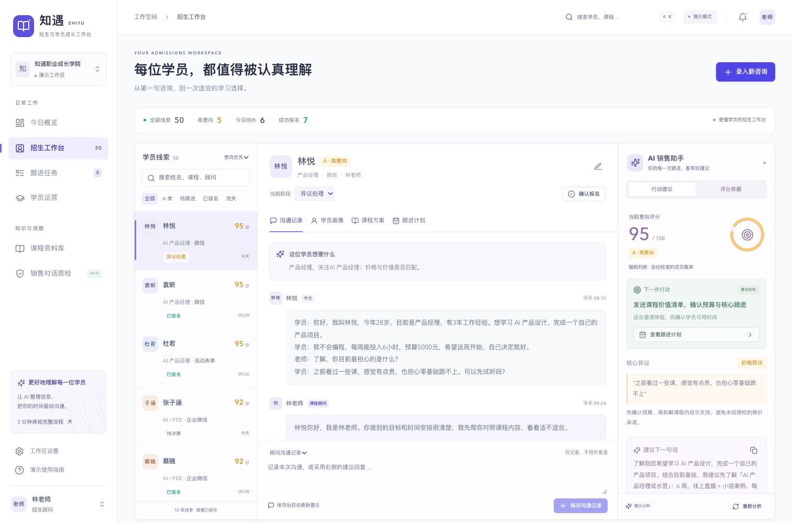

# 知遇 · AI 招生销售与学员运营助手

**今天哪些学员最值得跟进？**

知遇（`enrollment-copilot`）是面向职业教育、培训机构、知识付费与企业培训的单机构 CRM + AI Copilot 工作台。课程顾问可以把咨询记录转为客户画像、课程方案、销售建议和跟进任务；报名后继续管理学习进度、风险、续费与转介绍机会。

项目提供无需模型密钥的本地演示模式，以及可配置的 OpenAI Compatible API 接口。当前版本为可运行 MVP，适合客户演示、流程验证和二次开发，包含桌面三栏工作台和移动端导航。



上图为项目已有的真实运行截图，使用模拟线索，不代表实际客户数据或转化效果。更多操作见 [3 分钟演示脚本](docs/demo-guide.md)。

## 核心功能

| 模块         | 已实现能力                                                                               |
| ------------ | ---------------------------------------------------------------------------------------- |
| 今日概览     | 新增与有效线索、高意向、待跟进、报名、转化率、平均成交周期、销售漏斗、课程排行和流失原因 |
| 招生工作台   | 粘贴咨询、建立档案、沟通时间轴、画像人工校正、课程方案、异议与建议回复、下一步行动       |
| 课程匹配     | 综合目标、基础、预算与可投入时间，给出推荐理由、风险和不优先推荐的课程；课程资料可维护   |
| 意向评分     | 七维评分依据，A（80–100）/ B（60–79）/ C（35–59）/ D（0–34）；支持人工调整并标记         |
| 跟进任务     | 根据分析生成 7 天内的跟进计划；演示模式默认第 0、1、3、7 天，可改内容、日期和状态        |
| 报名流转     | 确认有效课程后创建学员档案、完成销售待办、生成入学引导任务；重复确认不会创建重复档案     |
| 学员运营     | 人工维护开课日期、进度、作业、活跃度，生成关注名单及运营待办，记录续费与转介绍状态       |
| 销售对话质检 | 批量粘贴或导入 TXT / JSON，对浪费线索、价格异议、不当承诺等给出原文证据与建议            |
| 设置与导出   | 查看模型和存储状态，导出工作区 JSON、任务 CSV、质检报告；确认后恢复演示数据              |

首次初始化包含 **50 条模拟线索、5 门课程、7 名学员**及质检案例。课程覆盖 AI / FDE、AI 产品经理、电商运营、Python、新媒体运营。日期以首次初始化时间为基准，日维度按 `Asia/Shanghai` 统计；已有工作区不会每天自动重置。

销售阶段：新线索 → 需求了解 → 课程匹配 → 价值建立 → 异议处理 → 报价 → 待决策 → 已报名 / 流失。

### 当前边界

- `AI_MODE=demo` 使用本地规则与模板，不调用大模型。它综合多个字段评分，但不代表真实模型推理或经过统计校准的成交概率。
- `AI_MODE=live` 才会把咨询、相关课程资料或学员数据发送给配置的模型服务。建议使用前由顾问复核，不承诺就业、收入或学习效果。
- 微信、企微、网页咨询等是录入来源标签；**未对接真实消息收发、支付或 LMS**。采用回复是填入编辑框，保存沟通是内部记录。
- 当前使用单机构工作区和可选共享密码，没有独立用户账号、角色权限、租户隔离或完整审计日志。`WORKSPACE_ID` 只是服务端存储键。
- 质检的已知结果统计排除“未知”样本，只表示样本内关联，不能证明某句话导致成交。
- 模型兼容接口有本地模拟契约测试；真实供应商与 Supabase 云端尚未完成联网验收。

## 技术架构

| 层次       | 实际实现                                                                |
| ---------- | ----------------------------------------------------------------------- |
| 运行环境   | Node.js 22+、npm、TypeScript 5.9                                        |
| Web 框架   | Next.js 16.4 App Router、React 19.3、服务端 Route Handlers              |
| UI         | Tailwind CSS 4、自定义 CSS、Radix UI / shadcn 风格本地组件、Lucide 图标 |
| 图表与校验 | Recharts 3、Zod 4、JSON Schema                                          |
| AI         | 独立 Provider，使用 `fetch` 调用 OpenAI Compatible Chat Completions API |
| 存储       | 默认本地 JSON；可选 Supabase PostgreSQL JSONB 工作区                    |
| 工程验证   | Node Test Runner + tsx、Playwright、TypeScript、Prettier                |

准确版本以 [package-lock.json](package-lock.json) 为准。浏览器调用同源 `/api/*`；服务端负责访问检查、输入校验、模型请求和存储。API Key 与 Supabase service-role key 不传给浏览器。

```text
enrollment-copilot/
├── src/app/                   # 页面入口、布局、样式与 API
│   └── api/                   # analyze / workspace / quality / operations / login / status
├── src/components/            # 七个业务页面、共享状态、对话框与按钮
├── src/lib/
│   ├── schema.ts              # 数据模型、输入和输出校验
│   ├── domain.ts              # 报名、任务、运营建议与统计口径
│   ├── store.ts               # 本地 / Supabase 持久化
│   ├── api.ts                 # 共享密码会话、来源检查与进程内限流
│   ├── seed.ts / catalog.ts   # 模拟线索与课程库
│   └── ai/                    # Provider、演示分析、销售质检与拆分 Prompt
├── supabase/schema.sql        # 数据库初始化与访问权限 SQL
├── tests/                     # 业务、鉴权、Provider 测试与浏览器 E2E
├── scripts/capture-demo.mjs   # 演示截图脚本
├── docs/                      # 演示、部署、验收记录及已有截图
├── .env.example               # 不含密钥的环境变量模板
└── package.json / package-lock.json
```

Prompt 分别位于 `src/lib/ai/prompts/`：`lead-analysis`、`student-profile`、`course-matching`、`objection-handling`、`lead-scoring`、`next-best-action`、`follow-up-plan`、`student-operation`、`quality-review`。前七个组合为一次销售分析请求，学员运营与质检分别请求。

## 快速开始

需要 Node.js **22 或更新版本**和 npm。私有仓库的克隆需要获得访问权限并配置 GitHub SSH 身份。

```bash
git clone git@github.com:bingyue/enrollment-copilot.git
cd enrollment-copilot
npm ci
cp .env.example .env.local
npm run dev
```

已有 `.env.local` 时保留自己的配置，不重复复制。默认 `AI_MODE=demo`，无需 API Key 或数据库，即可访问 [http://127.0.0.1:3210](http://127.0.0.1:3210)。服务只监听本机回环地址。

首次读取工作区时自动生成 `.data/workspace.json`。修改线索、课程、任务与学员后保存，刷新仍然保留。通过“设置 → 导出完整工作区”保存 JSON 备份；恢复演示数据会覆盖当前工作区，界面会要求确认。

## 配置说明

修改 `.env.local` 后重启服务。以下变量都是服务端配置，不应加 `NEXT_PUBLIC_` 前缀。

| 变量                        | 默认值 / 示例               | 用途                                                               |
| --------------------------- | --------------------------- | ------------------------------------------------------------------ |
| `AI_MODE`                   | `demo`                      | 仅 `live` 启用真实模型；其他值走演示模式                           |
| `LLM_BASE_URL`              | `https://api.openai.com/v1` | 兼容 API 基础 URL，程序追加 `/chat/completions`                    |
| `LLM_API_KEY`               | 空                          | 真实模型服务密钥，演示模式不需要                                   |
| `LLM_MODEL`                 | `gpt-4.1-mini`              | 请求的模型名称；按供应商和账号可用模型修改                         |
| `LLM_RESPONSE_FORMAT`       | `json_schema`               | 支持 `json_schema` 或 `json_object`；按供应商能力选择              |
| `APP_PASSWORD`              | 空                          | 非空时启用共享访问密码；只用于本机演示时可留空                     |
| `APP_PUBLIC`                | `false`                     | `true` 且缺少密码时拒绝业务访问；不改变监听地址，也不会发布网站    |
| `APP_ORIGIN`                | 空                          | 反向代理后的完整来源，例如 `https://crm.example.com`，不含业务路径 |
| `SUPABASE_URL`              | 空                          | 非空时切换至 Supabase，需同时配置服务端密钥                        |
| `SUPABASE_SERVICE_ROLE_KEY` | 空                          | Supabase 服务端专用密钥，不能提交或暴露给浏览器                    |
| `WORKSPACE_ID`              | `zhiyu-demo`                | Supabase 当前工作区主键，不是租户鉴权机制                          |
| `DATA_PATH`                 | `.data/workspace.json`      | 本地数据路径，相对路径基于启动目录；Supabase 模式不使用            |
| `NEXT_DIST_DIR`             | `.next`                     | Next.js 构建目录；开发 E2E 使用 `.next-e2e` 隔离                   |

### 真实模型

把 `AI_MODE` 改为 `live`，填写服务端密钥、基础 URL 和模型名称。OpenAI、DeepSeek、Qwen 等服务只要提供兼容接口即可按其配置接入；本仓库不保证所有模型支持相同的结构化输出选项。

Provider 请求超时为 55 秒。返回内容须经过 Zod 校验，销售分析还检查课程引用与七维分数，质检检查原文证据。失败时明确返回错误，**不会静默降级为演示结果**。请为自己的真实模型与课程数据补做联网验收。

### 数据库与持久化

- **本地模式**：写入经进程内队列串行化，采用临时文件加原子替换。只适合单 Node 进程和持久磁盘；不要让多个实例同时写同一个 JSON 文件，也不要依赖 Serverless 的临时文件系统。
- **Supabase 模式**：在自己的数据库执行 [supabase/schema.sql](supabase/schema.sql)，配置 `SUPABASE_URL`、`SUPABASE_SERVICE_ROLE_KEY` 和 `WORKSPACE_ID`。工作区整体存为 JSONB；使用版本条件更新处理并发冲突。SQL 开启 RLS 并禁止 `anon` / `authenticated` 直接访问，写入由服务端 service-role 执行。
- 切换存储**不会自动迁移本地数据**。新的 `WORKSPACE_ID` 会初始化模拟数据；有业务数据时先备份，再单独设计迁移和校验。当前没有界面化备份恢复或自动迁移脚本。

## 部署指南

### 本地生产构建

```bash
npm ci
npm run build
npm start
```

生产服务仍为 [http://127.0.0.1:3210](http://127.0.0.1:3210)。开发服务和生产服务不能同时占用此端口；切换前在对应终端停止旧进程。

### 服务器部署

项目需要 Node.js 服务端，不能直接部署为静态页面或 GitHub Pages。可在持久化服务器上运行上述生产命令，由 HTTPS 反向代理转发到 `127.0.0.1:3210`。设置 `APP_PUBLIC=true`、非空强访问密码和准确的 `APP_ORIGIN`；本地存储需指向持久目录并保持单进程。

当前仓库没有 Dockerfile、Compose、自动部署脚本或 GitHub Actions 工作流；不会自动创建公开部署。反向代理示例、备份操作与限制见 [部署与运维说明](docs/deployment.md)。生产接入前还应处理 [本次检查记录](docs/repository-check.md) 中的依赖审计结果。

## 使用示例

### 从咨询到学员运营

点击“录入新咨询”，填写姓名、来源、顾问，粘贴以下模拟内容：

```text
学员：我今年28岁，是产品经理，想学习AI产品设计。我是零基础，不会编程。
学员：预算5000元，每周能投入6小时，希望本周确定课程，担心学不会和价格太贵。
老师：我先了解您的学习目标和时间，再帮您比较课程和试听安排。
```

点击“分析并建立档案”，检查画像、课程推荐、评分依据、异议、回复和跟进计划。采用回复后可编辑并保存沟通；确认报名时选择课程，随后在学员运营中更新学习进度。完整录屏流程见 [演示脚本](docs/demo-guide.md)。

### 查看服务状态

服务运行后可执行以下只读命令，不会新增线索或重置工作区：

```bash
curl --fail --silent http://127.0.0.1:3210/api/status
```

默认演示配置返回 `mode: "demo"`、`storage: "本地持久化"` 等状态。`authorized` 表示当前请求的访问资格，不等于真实模型或数据库连通性检测。

### 导入销售质检

在“销售对话质检 → 批量导入对话”中粘贴 TXT；每段用 `---` 分隔：

```text
顾问=林老师;学员=小周;结果=未知
学员：我想学AI产品设计，预算5000，有点担心课程效果。
老师：我们先确认一下基础和学习目标，您每周能投入多少时间？
---
顾问=陈老师;学员=小李;结果=未报名
学员：我想学Python，零基础。价格有点贵。
老师：都是这个价，您考虑好了再联系。
```

单次支持 1–20 段、每段 12–12,000 字；结果支持“未知 / 已报名 / 未报名”。JSON 文件使用数组或 `{ "conversations": [...] }` 包装，每项包含 `advisor`、`leadName`、`outcome`、`transcript` 字段。只导入有权限处理的记录。

## 开发指南

```bash
npm run dev             # 本地开发，127.0.0.1:3210
npm run typecheck       # TypeScript 检查
npm test                # 业务、鉴权和模型兼容接口测试
npm run format:check    # 检查 Prettier 格式
npm run build           # 生产构建
npm run test:e2e        # Chrome 浏览器端到端测试
```

E2E 使用已安装的 Google Chrome、独立端口 `3211`、`.data/e2e-workspace.json` 和 `.next-e2e`，强制演示模式且不连接 Supabase。确保端口空闲；缺少 Chrome 时先安装 Chrome。生产构建后的浏览器验收使用：

```bash
npm run build
E2E_PRODUCTION=true npm run test:e2e
```

通过 `npm run format` 按现有规范格式化。当前没有 ESLint 脚本，不要使用不存在的 `npm run lint`。需要截图时启动仅含模拟数据的本地演示服务，再运行 `npm run capture:demo`；脚本会覆盖 `docs/screenshots/` 中同名图片，可用 `DEMO_URL` 指向独立演示实例。

修改业务规则时同步更新 Zod Schema、Prompt 和对应测试；修改 UI 时检查桌面、移动端与无数据状态。提交前保留 `.env.example` 空密钥模板，排除 `.env.local`、`.data`、数据库备份与测试产物。不要把学员真实聊天或密钥放进截图、Issue 或测试夹具。

私有仓库的协作需要作者授予访问权限。贡献前阅读 [贡献指南](CONTRIBUTING.md)、[现有验收记录](docs/verification.md) 和 [本次仓库检查](docs/repository-check.md)；Pull Request 应说明行为变化、验证方式和已知限制。

## 许可证与商业授权

**授权模式待作者明确确认，当前尚未添加项目 LICENSE。** 本节会在选择确认后与正式许可证同步。不能因为可以查看仓库，就推定已经获得使用、修改、分发或商业授权。

候选方案是标准 Apache License 2.0，或“非商业免费 + 商业书面授权”。后者已准备 [待审核草案](docs/license-draft.md)，尚未生效。Apache 2.0 本身允许商业使用，不能用额外的商业授权要求撤销这一许可；自定义非商业许可不应称为 OSI 认可的开源许可证。参见 [Apache 官方 FAQ](https://www.apache.org/foundation/license-faq.html) 与 [Open Source Definition](https://opensource.org/osd)。

第三方组件仍遵循各自许可证，项目版权声明不覆盖第三方权利。依赖版本、许可证索引与原始声明见 [THIRD_PARTY_NOTICES.md](THIRD_PARTY_NOTICES.md)。商业授权联系方式：**待补充**。

Copyright (c) 2026 越哥（越哥聊AI）

FDE前线 | [https://FDEOpen.com](https://FDEOpen.com)

### 关于作者

**越哥｜越哥聊AI**

专注 AI 智能体、企业 AI 转型、AI Coding 与 AI 产品工程化实践。

- 作者：越哥
- 全网同名：越哥聊AI
- 技术社区：FDE前线
- 官方网站：[https://FDEOpen.com](https://FDEOpen.com)

欢迎交流 AI 技术、企业 AI 落地和开源项目实践。
